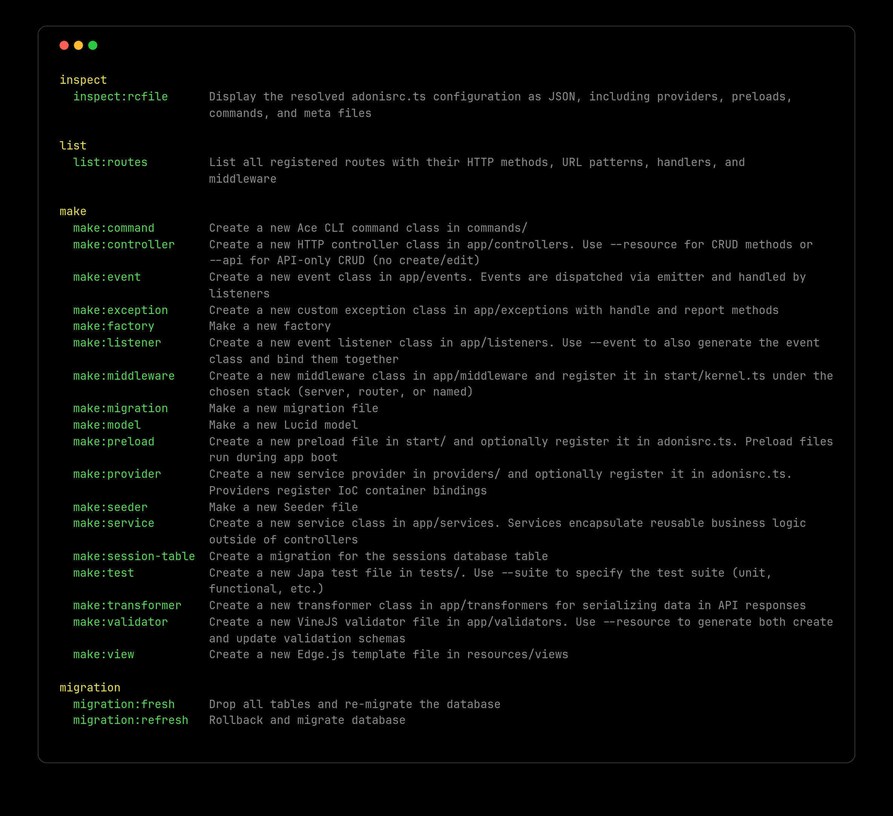

# Ace Command line

This guide introduces you to the Ace command line. You will learn about the following topics:

- Running Ace commands
- Viewing help documentation  
- Creating command aliases
- Running commands programmatically
- Capturing the output of programmatic commands

## Overview

Ace is AdonisJS's command line framework that powers all console commands in your application. Whether you're running database migrations, creating controllers, or building custom CLI tools, Ace provides the foundation for all command line interactions.

The framework handles command parsing, argument validation, interactive prompts, and terminal output formatting, allowing you to focus on building command logic rather than dealing with CLI boilerplate. Every AdonisJS application includes Ace by default, accessible through the `ace.js` entry point file in your project root.

Understanding how to use Ace effectively is essential for AdonisJS development, as you'll interact with it constantly during development and deployment.

## Running Ace commands

You can execute Ace commands using the `ace.js` file located in your project root. This file serves as the entry point for all command line operations.

:::warning
Do not modify the `ace.js` file directly. If you need to add custom code that runs before Ace starts, put it in the `bin/console.ts` file instead.
:::

```sh
node ace
node ace make:controller
node ace migration:run
```

## Viewing available commands

To see a list of all available commands in your application, run the ace entry point without any arguments or use the `list` command explicitly.

```sh
node ace

# Same as above
node ace list
```

Both commands display the same help screen, showing all registered commands organized by category.

:::media

:::

:::note

The help output follows the [docopt](http://docopt.org/) standard, a specification for command line interfaces that ensures consistent documentation formatting across different tools.

:::

## Getting help for specific commands

Every Ace command includes built-in help documentation. To view detailed information about a specific command, including its arguments, flags, and usage examples, append the `--help` flag to any command.

```sh
node ace make:controller --help
```

The help screen shows the command's description, required and optional arguments, available flags with their descriptions, and usage examples.

## Controlling color output

Ace automatically detects your terminal environment and disables colorful output when the terminal doesn't support ANSI colors. However, you can manually control color output using the `--ansi` flag.

```sh
# Disable colors
node ace list --no-ansi

# Force enable colors
node ace list --ansi
```

Disabling colors is useful when redirecting command output to files or when running commands in CI/CD environments that don't support colored terminal output.

## Creating command aliases

Command aliases provide shortcuts for frequently used commands with specific flag combinations. This is particularly useful when you find yourself repeatedly typing the same command with the same flags.

You can define aliases in the `adonisrc.ts` file using the `commandsAliases` object. Each alias maps a short name to a complete command with its flags.

```ts title="adonisrc.ts"
export default defineConfig({
  commandsAliases: {
    /**
     * Create a singular resourceful controller
     */
    resource: 'make:controller --resource --singular'
  }
})
```

Once defined, you can use the alias name instead of typing the full command. Any additional arguments you provide are appended to the expanded command.

```sh
# Using the alias
node ace resource users

# Expands to
node ace make:controller --resource --singular users
```

### How alias expansion works

When you run a command, Ace follows this expansion process:

1. Ace checks if the command name matches any alias in the `commandsAliases` object
2. If a match is found, Ace extracts the first word from the alias value (before any spaces) and looks up the corresponding command
3. If a command exists with that name, Ace appends all remaining segments from the alias value to form the complete command
4. Finally, Ace appends any arguments or flags you provided when running the alias

For example, if you run:

```sh
node ace resource admin --help
```

Ace expands this to:

```sh
node ace make:controller --resource --singular admin --help
```

The expansion preserves argument order and allows you to add additional flags beyond those defined in the alias.

## Running commands programmatically

You can execute Ace commands from within your application code using the `ace` service. This is useful for building workflows that need to trigger commands programmatically, such as running migrations during application setup or generating files based on user actions.

The `ace` service is available after your application has been booted, ensuring all necessary services and providers are loaded before command execution.

```ts
import ace from '@adonisjs/core/services/ace'

/**
 * Execute a command and get its result
 */
const command = await ace.exec('make:controller', [
  'users',
  '--resource',
])

/**
 * The command object contains execution details
 */
console.log(command.exitCode) // 0 for success, 1 for failure
console.log(command.result)   // Command return value
console.log(command.error)    // Error object if command failed
```

Before executing commands, you should verify that the command exists to avoid runtime errors. Use the `ace.hasCommand` method to check command availability.

```ts
import ace from '@adonisjs/core/services/ace'

/**
 * Boot Ace to load all registered commands
 * (if not already loaded)
 */
await ace.boot()

if (ace.hasCommand('make:controller')) {
  await ace.exec('make:controller', [
    'users',
    '--resource',
  ])
} else {
  console.log('Controller command not available')
}
```

The `ace.boot()` method loads all commands if they haven't been loaded already. This ensures the `hasCommand` check works correctly by verifying against the complete command registry.

### Capturing command output

Commands executed with `ace.exec` write their logs, tables, and other UI output to the terminal, just like commands run from the shell. When you run a command as part of a larger workflow, this output can be noisy or you may want to inspect it yourself.

You can pass a custom UI instance as the third argument to `ace.exec`. The following example creates a UI in `raw` mode, which keeps all output in memory instead of writing it to the terminal.

```ts title="app/services/scaffolding_service.ts"
import ace from '@adonisjs/core/services/ace'
import { cliui } from '@adonisjs/core/ace'

/**
 * Raw mode stores the output in memory
 */
const ui = cliui({ mode: 'raw' })

const command = await ace.exec('make:controller', ['users'], { ui })

/**
 * Read the captured log messages
 */
console.log(ui.logger.getLogs())
// [{ message: '...', stream: 'stdout' }, ...]
```

The custom UI only applies to the executed command. Errors that the command does not handle are still rendered by Ace using its default UI.
