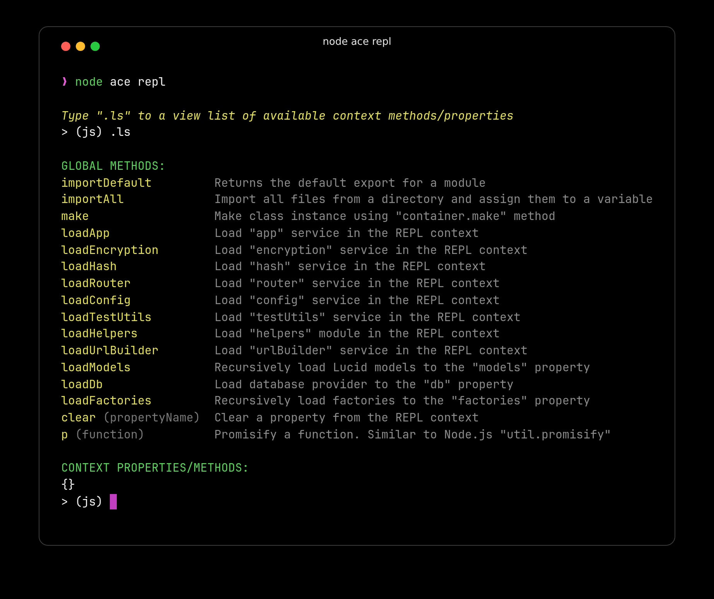

# REPL

In this guide, you will learn about the following topics:

- Starting and navigating the REPL session
- Importing modules and accessing services
- Using built-in helper methods
- Accessing command history and results
- Adding custom REPL methods
- Working with the editor mode

## Overview

The AdonisJS REPL extends the standard [Node.js REPL](https://nodejs.org/api/repl.html) with application-aware features that make it easy to interact with your codebase. Unlike the basic Node.js REPL, the AdonisJS REPL boots your application, loads its services, and provides convenient shortcuts for common tasks.

The REPL is particularly useful during development for quick experimentation, debugging, and data exploration. You can import TypeScript files directly, access container services without manual imports, create class instances through the IoC container, and extend the REPL with custom methods specific to your application.

## Starting the REPL session

You can start the REPL session using the `node ace repl` command. This boots your AdonisJS application and opens an interactive prompt where you can execute code.

```sh
node ace repl
```

:::media

:::

Once started, you'll see a prompt where you can type JavaScript code and press Enter to execute it. The output appears immediately on the following line, creating a fast feedback loop for testing and exploration.

## Using editor mode

While the REPL is great for single-line expressions, you sometimes need to write multi-line code blocks. The editor mode allows you to write multiple lines of code before executing them.

Enter editor mode by typing the `.editor` command at the REPL prompt.

```sh
> (js) .editor
# // Entering editor mode (Ctrl+D to finish, Ctrl+C to cancel)
```

In editor mode, you can write multiple lines of code. Press `Ctrl+D` to execute the entire code block, or press `Ctrl+C` to cancel and exit editor mode without executing anything.

```sh
> (js) .editor

# // Entering editor mode (Ctrl+D to finish, Ctrl+C to cancel)
const users = await User.query()
  .where('isActive', true)
  .orderBy('createdAt', 'desc')
  .limit(10)

console.log(`Found ${users.length} active users`)
# // Press Ctrl+D to execute
```

## Accessing previous results

The REPL provides special variables for accessing results and errors from previously executed commands, eliminating the need to re-run code when you forget to store a value.

### Accessing the last result

If you execute a statement but forget to assign its result to a variable, you can access it using the `_` (underscore) variable.

```sh
> (js) helpers.string.random(32)
# 'Z3y8QQ4HFpYSc39O2UiazwPeKYdydZ6M'

> (js) _
# 'Z3y8QQ4HFpYSc39O2UiazwPeKYdydZ6M'

> (js) _.length
# 32
```

This is particularly useful when you want to perform additional operations on a result without re-executing the original command.

### Accessing the last error

Similarly, you can access any exception raised by the previous command using the `_error` variable. This is helpful for inspecting error details without cluttering your code with try/catch blocks.

```sh
> (js) helpers.string.random()
# Error: The value of "size" is out of range...

> (js) _error.message
# 'The value of "size" is out of range. It must be >= 0 && <= 2147483647. Received NaN'

> (js) _error.stack
# (full error stack trace)
```

## Navigating command history

The REPL maintains a history of all commands you've executed, saved in the `.adonisjs_v6_repl_history` file in your home directory. This allows you to recall and re-execute previous commands without retyping them.

You can navigate through command history in two ways:

- **Arrow key navigation**: Press the up arrow `↑` key to cycle through previous commands one at a time. Press the down arrow `↓` to move forward through the history.

- **Search mode**: Press `Ctrl+R` to enter reverse search mode, then type characters to search for matching commands in your history. Press `Ctrl+R` again to cycle through multiple matches.

```sh
> (js) [Press Ctrl+R]
(reverse-i-search)`query': const users = await User.query()
```

## Exiting the REPL session

You can exit the REPL session by typing `.exit`, pressing `Ctrl+D`, or pressing `Ctrl+C` twice in quick succession.

```sh
> (js) .exit
```

When you exit, AdonisJS performs a graceful shutdown, closing database connections and cleaning up resources before the process terminates.

Note that the REPL session does not automatically reload when you modify your codebase. If you change your application code, you must exit and restart the REPL session for the changes to take effect.

## Importing modules

Node.js does not support `import` statements in REPL sessions, so you must use dynamic `import()` expressions instead. When importing, you need to destructure the module exports or access specific properties.

```sh
> (js) const { default: User } = await import('#models/user')
# undefined

> (js) await User.all()
# [User, User, User, ...]
```

The syntax `const { default: User }` destructures the default export from the module. This can be verbose when you only want the default export.

### Using the importDefault helper

To simplify importing default exports, the REPL provides an `importDefault` helper method that automatically extracts the default export.

```sh
> (js) const User = await importDefault('#models/user')
# undefined

> (js) const Post = await importDefault('#models/post')
# undefined

> (js) await Post.query().where('published', true)
# [Post, Post, Post, ...]
```

This is particularly convenient when working with models, services, or any modules that export a single default value.

## Using helper methods

The REPL includes several built-in helper methods that provide shortcuts for common tasks like importing services, making class instances, and managing the REPL context.

You can view all available helper methods by typing the `.ls` command. It also lists the properties currently stored in the REPL context under the `CONTEXT PROPERTIES/METHODS` heading.

```sh
> (js) .ls

# GLOBAL METHODS:
importDefault         Returns the default export for a module
importAll             Import all files from a directory and assign them to a variable
make                  Make class instance using "container.make" method
loadApp               Load "app" service in the REPL context
loadEncryption        Load "encryption" service in the REPL context
loadHash              Load "hash" service in the REPL context
loadRouter            Load "router" service in the REPL context
loadConfig            Load "config" service in the REPL context
loadTestUtils         Load "testUtils" service in the REPL context
loadHelpers           Load "helpers" module in the REPL context
loadUrlBuilder        Load "urlBuilder" service in the REPL context
clear (propertyName)  Clear a property from the REPL context
p (function)          Promisify a function. Similar to Node.js "util.promisify"
```

Packages can register their own helper methods too. For example, when Lucid is installed, the list also includes `loadModels`, `loadDb`, and `loadFactories`.

### Loading services

Instead of manually importing services, you can use the `load*` helper methods to load them into the REPL context.

```sh
> (js) await loadRouter()
# Loaded "router" service. You can access it using the "router" variable

> (js) router.toJSON()
# { root: [...] }

> (js) await loadHash()
# Loaded "hash" service. You can access it using the "hash" variable

> (js) await hash.make('secret')
# '$argon2id$v=19$m=65536,t=3,p=4$...'
```

Each `load*` method imports the corresponding service and makes it available as a property in the REPL context, eliminating the need for import statements.

### Importing a directory

The `importAll` method imports every file inside a directory (recursively) and returns an object keyed by file name (without the extension). Files inside nested directories become nested objects. The path is resolved from the application root.

```sh
> (js) const validators = await importAll('app/validators')
# undefined

> (js) Object.keys(validators)
# ['post', 'user', ...]
```

### Making class instances

The `make` method uses the [IoC container](../concepts/dependency_injection.md#constructing-a-tree-of-dependencies) to create class instances with automatic dependency injection. It accepts a class constructor or a container binding name, so you must import the class first.

```sh
> (js) const UserService = await importDefault('#services/user_service')
# undefined

> (js) const userService = await make(UserService)
# undefined

> (js) await userService.findById(1)
# User { id: 1, email: 'user@example.com', ... }
```

This is useful when you want to test services or classes that have constructor dependencies, as the container automatically resolves and injects them.

### Promisifying functions

The `p` method promisifies callback-based functions, similar to Node.js `util.promisify`.

```sh
> (js) const readFile = p(fs.readFile)
# undefined

> (js) await readFile('package.json', 'utf8')
# '{ "name": "my-app", ... }'
```

## Adding custom REPL methods

You can extend the REPL with custom methods specific to your application. This is useful for creating shortcuts that you use frequently during development, such as loading all models or seeding test data.

Custom methods are typically defined in a [preload file](../../reference/adonisrc_file.md#preloads) that runs only in the REPL environment.

### Creating a REPL preload file

First, generate a preload file configured to run only in the REPL environment.

```sh
node ace make:preload repl -e=repl

# CREATE: start/repl.ts
```

### Defining a custom method

In the preload file, use `repl.addMethod` to define custom methods. For example, let's create a method that imports all services from the `app/services` directory.

```ts title="start/repl.ts"
import app from '@adonisjs/core/services/app'
import repl from '@adonisjs/core/services/repl'
import { fsImportAll } from '@adonisjs/core/helpers'

repl.addMethod(
  'loadServices',
  async (replInstance) => {
    /**
     * Import all files from the services directory and
     * make them available in the REPL context
     */
    replInstance.server!.context.services = await fsImportAll(
      app.makePath('app/services')
    )

    /**
     * Print a message and display the prompt again
     */
    replInstance.notify(
      'Imported services. You can access them using the "services" property'
    )
  },
  {
    description: 'Load all services from app/services directory',
    usage: 'await loadServices()',
  }
)
```

The `repl.addMethod` accepts three parameters:

1. **Method name**: The name you'll use to call the method in the REPL. Registering a method with an existing name (for example, Lucid's `loadModels`) replaces it.
2. **Implementation**: A function that receives the `Repl` instance as the first argument, followed by the arguments passed when calling the method in the REPL.
3. **Options** (optional): An object with `description` and `usage` properties displayed by the `.ls` command.

### Using your custom method

After restarting the REPL session, your custom method becomes available.

```sh
node ace repl

> (js) .ls
# GLOBAL METHODS:
# await loadServices()  Load all services from app/services directory
# ...

> (js) await loadServices()
# Imported services. You can access them using the "services" property

> (js) Object.keys(services)
# ['post_service', 'user_service', ...]
```

You can define multiple custom methods in the same preload file to create a comprehensive set of development shortcuts tailored to your application's needs.
