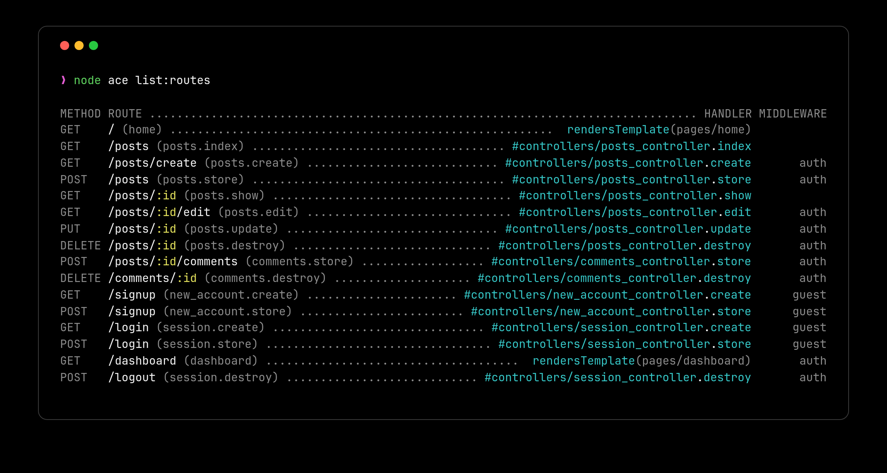

# Routing

This guide covers routing in AdonisJS applications. You will learn how to:

- Define routes for different HTTP methods
- Handle dynamic route parameters with validation
- Organize routes into groups with shared configuration
- Generate RESTful resource routes
- Apply middleware to routes
- Register domain-specific routes
- Build type-safe URLs using the URL builder
- Extend the router with custom functionality

## Overview

Routing connects incoming HTTP requests to specific handlers in your application. When a user visits URLs like `/`, `/about`, or `/posts/1`, the router examines the HTTP method and URL pattern, then executes the appropriate handler function. This is the foundation of how your application responds to web requests.

A route consists of three main components:

- **HTTP method** – The type of request (GET, POST, PUT, DELETE, etc.)
- **URI pattern** – The URL path that should match, which can include dynamic segments
- **Handler** – The function or [controller](./controllers.md) method that processes the request and returns a response

Routes can also include [middleware](./middleware.md) for authentication, rate-limiting, or any logic that should run before the handler executes. Every HTTP request your application handles flows through the routing system, making it essential to understand how routes work and how to organize them effectively.

## Basic example

In AdonisJS, routes are defined inside the `start/routes.ts` file using the router service.

A route handler is the function that runs when a route matches. It receives the HTTP context and can return a string, an object, or call services to produce a response.

The following example shows static routes and a dynamic route using `:id`, which matches any value passed in that segment.

```ts title="start/routes.ts"
import router from '@adonisjs/core/services/router'

router.get('/', () => 'Hello world from the home page.')

router.get('/about', () => 'This is the about page.')

router.get('/posts/:id', ({ params }) => {
  return `This is post with id ${params.id}`
})

router.post('/users', async ({ request }) => {
  const data = request.all()
  await createUser(data)
  return 'User created successfully'
})
```

### Using a controller as a route handler

Instead of inline callbacks, you can delegate request handling to a controller method. Controllers help organize logic into dedicated classes and make handlers reusable across multiple routes.

See also: [Controllers guide](./controllers.md) and [HTTP Context documentation](./http_context.md)

```ts title="start/routes.ts"
import router from '@adonisjs/core/services/router'
import { controllers } from '#generated/controllers'

router.get('/posts/:id', [controllers.Posts, 'show'])
```

## Viewing registered routes

You can view all routes registered by your application using the Ace CLI command below. This is helpful for debugging, verifying route names, or checking which middleware is attached to specific routes.
```sh
node ace list:routes
```

:::media

:::

If you're using the [official VSCode extension](https://marketplace.visualstudio.com/items?itemName=jripouteau.adonis-vscode-extension), routes are also visible directly from the VSCode activity bar, making it easy to navigate your application's endpoints.

:::media

:::

## Route params

Route params allow parts of the URL to be dynamic, capturing values from specific segments and making them available in your handler. Each param matches any value in that position and is accessible via `ctx.params`.

### Basic route params

A basic route param is defined with a colon `:` followed by a name. The captured value can be accessed in your handler through the `params` object.

```ts title="start/routes.ts"
import router from '@adonisjs/core/services/router'

router.get('/posts/:id', ({ params }) => {
  return `Showing post with id: ${params.id}`
})
```

When someone visits `/posts/42`, the value `42` is captured and `params.id` equals `"42"` (as a string).

### Multiple route params

You can include more than one param in a single route. Each param must have a unique name and is separated by `/`.

```ts title="start/routes.ts"
import router from '@adonisjs/core/services/router'

router.get('/posts/:id/comments/:commentId', ({ params }) => {
  console.log(params.id)        // Post ID
  console.log(params.commentId) // Comment ID
})
```

This matches URLs like `/posts/42/comments/7`, capturing both values.

### Optional route params

Sometimes, a parameter is not always required. You can mark it optional by appending `?` to its name. Optional params must be the last segment in the route pattern.

```ts title="start/routes.ts"
import router from '@adonisjs/core/services/router'

router.get('/posts/:id?', ({ params }) => {
  if (!params.id) {
    return 'Showing all posts'
  }
  return `Showing post with id ${params.id}`
})
```

This route matches both `/posts` and `/posts/42`.

### Wildcard route params

A wildcard param captures all remaining segments of the URL as an array. It is defined using `*` and must appear last in the pattern.

```ts title="start/routes.ts"
import router from '@adonisjs/core/services/router'

router.get('/docs/:category/*', ({ params }) => {
  console.log(params.category)  // 'guides'
  console.log(params['*'])      // ['sql', 'orm', 'query-builder']
})
```

When someone visits `/docs/guides/sql/orm/query-builder`, the wildcard captures `['sql', 'orm', 'query-builder']`.

Use wildcard params for:
- Documentation paths with nested sections
- File browsers with directory structures
- Catch-all routes that need to capture arbitrary depth

## Route param validation

By default, route params accept any value and are always passed to your handler as strings. You can restrict which values are valid and automatically cast them to the correct type using the `.where()` method.

When a param fails validation, the router skips that route and continues searching for other matching routes. This allows you to have multiple routes with the same pattern but different validation rules.

### Why validate params

Without validation, you need to manually check and convert params in every handler.

```ts title="❌ Without param validation"
router.get('/posts/:id', ({ params, response }) => {
  if (!/^[0-9]+$/.test(params.id)) {
    return response.badRequest('Invalid ID format')
  }
  const id = Number(params.id)
  // Now use id...
})
```

With param validation, the router handles this automatically before your handler runs.

```ts title="✅ With param validation"
router
  .get('/posts/:id', ({ params }) => {
    console.log(typeof params.id) // 'number'
    // params.id is already validated and cast to number
  })
  .where('id', {
    match: /^[0-9]+$/,
    cast: (value) => Number(value),
  })
```

Use param validation to:
- Ensure IDs are numeric before querying databases
- Validate UUIDs match the correct format
- Verify slugs contain only URL-safe characters
- Prevent invalid data from reaching your handler
- Automatically cast strings to proper types (number, boolean, etc.)

### Custom matchers

The `.where()` method accepts an object with two properties: `match` for validation and `cast` for type conversion.

```ts title="start/routes.ts"
import router from '@adonisjs/core/services/router'

router
  .get('/posts/:id', ({ params }) => {
    console.log(typeof params.id) // 'number'
    console.log(params.id)        // 42 (not "42")
  })
  .where('id', {
    match: /^[0-9]+$/,              // Only digits allowed
    cast: (value) => Number(value), // Convert string to number
  })
```

If someone visits `/posts/abc`, this route won't match because "abc" fails the regex test. The router continues searching for other routes, or returns 404 if none match.

### Built-in matchers

For common patterns like numbers, UUIDs, and slugs, AdonisJS provides shorthand matchers that handle both validation and type casting.

| Matcher | Validates | Casts To | Example Use Case |
|---------|-----------|----------|------------------|
| `number()` | Digits only (`/^\d+$/`) | `number` | Database IDs, pagination offsets |
| `uuid()` | Valid UUID v4 format | `string` | Public resource identifiers, secure IDs |
| `slug()` | URL-safe strings (`/^[a-z0-9-_]+$/`) | `string` | SEO-friendly URLs, article slugs |

```ts title="Numeric IDs"
import router from '@adonisjs/core/services/router'

router
  .get('/posts/:id', ({ params }) => {
    console.log(typeof params.id) // 'number'
  })
  .where('id', router.matchers.number())
```

```ts title="UUID identifiers"
import router from '@adonisjs/core/services/router'

router
  .get('/users/:userId', ({ params }) => {
    console.log(params.userId) // '550e8400-e29b-41d4-a716-446655440000'
  })
  .where('userId', router.matchers.uuid())
```

```ts title="URL-friendly slugs"
import router from '@adonisjs/core/services/router'

router
  .get('/articles/:slug', ({ params }) => {
    console.log(params.slug) // 'getting-started-with-adonisjs'
  })
  .where('slug', router.matchers.slug())
```

### Global matchers

You can apply matchers globally so every route inherits the same validation rules automatically. This is useful when most of your routes follow a convention, like using UUIDs for all IDs.

```ts title="start/routes.ts"
import router from '@adonisjs/core/services/router'

// Set a global default: all :id params must be UUIDs
router.where('id', router.matchers.uuid())

// These routes automatically inherit the UUID matcher
router.get('/posts/:id', () => {})
router.get('/users/:id', () => {})

// Override for a specific route that needs numeric IDs
router
  .get('/categories/:id', () => {})
  .where('id', router.matchers.number())
```

Global matchers are applied first, then route-specific matchers override them. This pattern helps maintain consistency while allowing exceptions where needed.

## HTTP methods

The router provides dedicated methods for each standard HTTP verb. Each method corresponds to a specific type of operation in RESTful applications.

| Method | Purpose | Common Use Case |
|--------|---------|-----------------|
| `GET` | Retrieve resources | Display a list of users, show a blog post, fetch data |
| `POST` | Create new resources | Submit a form, create a new user, upload a file |
| `PUT` | Replace entire resources | Update all fields of a user profile |
| `PATCH` | Update partial resources | Update only the email field of a user |
| `DELETE` | Remove resources | Delete a blog post, remove a user account |
| `QUERY` | Run a query with a request body | Search with filters too complex to fit in a URL |

```ts title="start/routes.ts"
import router from '@adonisjs/core/services/router'

router.get('/users', () => {})           // List all users
router.post('/users', () => {})          // Create a new user
router.put('/users/:id', () => {})       // Replace user completely
router.patch('/users/:id', () => {})     // Update specific user fields
router.delete('/users/:id', () => {})    // Delete a user
router.query('/users/search', () => {})  // Search users using the request body
```

### The QUERY method

`QUERY` is a newer HTTP method defined by [RFC 10008](https://www.rfc-editor.org/rfc/rfc10008.html). Like `GET`, it is safe and idempotent, and its responses are cacheable. Like `POST`, it sends the query in the request body. Use it for search or filter endpoints whose input is too large or too structured to fit in a URL, where you would otherwise reach for a `POST` route that doesn't change anything.

```ts title="start/routes.ts"
router.query('/products/search', async ({ request }) => {
  const { filters, sort, limit } = request.body()
  // run the search
})
```

```sh
curl -X QUERY http://localhost:3333/products/search \
  -H 'Content-Type: application/json' \
  -d '{"filters":{"category":"books","price":{"lte":30}},"sort":"-rating","limit":20}'
```

The spec requires every `QUERY` request to declare its `Content-Type`, so AdonisJS rejects `QUERY` requests without a valid `Content-Type` header with a `400 Bad Request` response.

:::note
The [bodyparser](./body_parser.md) only parses the body for the methods listed in the `allowedMethods` option. Make sure `'QUERY'` is part of that list in `config/bodyparser.ts`, otherwise `request.body()` will be empty for `QUERY` requests.
:::

### Matching multiple methods

To match all HTTP methods or specify custom verbs:
```ts title="start/routes.ts"
import router from '@adonisjs/core/services/router'

// Matches GET, POST, PUT, PATCH, DELETE, and all other methods
router.any('/reports', () => {})

// Match specific custom HTTP methods
router.route('/', ['TRACE'], () => {})
router.route('/api/data', ['GET', 'POST', 'PUT'], () => {})
```

The `.any()` method is useful for endpoints that need to respond to any HTTP method, such as webhook receivers or catch-all debugging routes.

## Route middleware

**Middleware** are functions that execute before your route handler, allowing you to run code like authentication checks, logging, rate limiting, or request transformation. Think of middleware as a series of checkpoints that requests pass through before reaching your main handler.

See also: [Middleware guide](./middleware.md)

```ts title="start/routes.ts"
import router from '@adonisjs/core/services/router'
import { middleware } from '#start/kernel'

router
  .get('/posts', () => {
    console.log('Inside route handler')
    return 'Viewing all posts'
  })
  .use(middleware.auth())
```

You can also attach inline middleware directly.

```ts title="start/routes.ts"
router
  .get('/posts', () => {
    console.log('Inside route handler')
    return 'Viewing all posts'
  })
  .use((ctx, next) => {
    console.log('Inside middleware')
    return next()
  })
```

## Route identifiers

Each route can have a unique **name** that you can use to generate URLs or redirects without hardcoding paths. This keeps your URLs maintainable, if you change a route's path, all references automatically update when using the name.

Named routes are essential for:
- Generating URLs in templates without hardcoding paths
- Creating redirects that survive URL changes
- Building navigation menus programmatically
- Organizing routes with meaningful identifiers

You can provide unique names to routes using the `.as` method.

:::note
When using controllers, routes are automatically named after the `controller+method` name.
:::

See also: [URL builder](./url_builder.md)

```ts title="start/routes.ts"
import router from '@adonisjs/core/services/router'

router.get('/users', () => {}).as('users.index')
router.post('/users', () => {}).as('users.store')
router.get('/users/:id', () => {}).as('users.show')
router.delete('/users/:id', () => {}).as('users.destroy')
```

## Grouping routes

Route groups let you apply shared configuration to multiple routes at once, eliminating repetition and making your route file easier to maintain. Without groups, you'd need to repeat the same prefix, middleware, or naming convention on every individual route, creating duplication that becomes error-prone as your application grows.

Use route groups when you have multiple routes that share any of the following:
- **URL prefix** – API versions (`/v1`, `/v2`), admin sections (`/admin`), or language codes (`/en`, `/es`)
- **Middleware** – Authentication, authorization, rate limiting, or CORS settings
- **Naming convention** – Namespace prefixes for organized route names
- **Domain** – Multi-tenant applications with subdomain routing
```ts title="start/routes.ts"
import router from '@adonisjs/core/services/router'
import { middleware } from '#start/kernel'

router
  .group(() => {
    router.get('/users', () => {}).as('users.index')
    router.post('/users', () => {}).as('users.store')
    router.get('/posts', () => {}).as('posts.index')
    router.post('/posts', () => {}).as('posts.store')
  })
  .prefix('/api')
  .use(middleware.auth())
  .as('api')
```

### Prefixing routes

Prefixes are prepended to all routes inside a group. This is especially useful for API versioning, admin areas, or organizing related resources under a common path segment.
```ts title="start/routes.ts"
import router from '@adonisjs/core/services/router'

router
  .group(() => {
    router.get('/users', () => {})      // Becomes: GET /api/users
    router.get('/payments', () => {})   // Becomes: GET /api/payments
    router.get('/invoices', () => {})   // Becomes: GET /api/invoices
  })
  .prefix('/api')
```

### Naming routes inside a group

When routes inside a group have names, you can prefix their names as well. This creates organized route namespaces that make it clear which routes belong together.

Named route groups make URL generation clearer and help you avoid naming collisions between different sections of your application. For example, you might have both `web.users.index` and `api.users.index` routes that serve different purposes.

See also: [URL builder](./url_builder.md)

```ts title="start/routes.ts"
import router from '@adonisjs/core/services/router'

router
  .group(() => {
    router.get('/users', () => {}).as('users.index')      // Name: api.users.index
    router.post('/users', () => {}).as('users.store')     // Name: api.users.store
    router.get('/posts', () => {}).as('posts.index')      // Name: api.posts.index
  })
  .prefix('/api')
  .as('api')
```

### Applying middleware to a group

You can attach middleware at the group level. Group middleware executes before any route-level middleware, creating a pipeline where shared logic runs first, followed by route-specific logic.

See also: [Middleware guide](./middleware.md)

```ts title="start/routes.ts"
import router from '@adonisjs/core/services/router'
import { middleware } from '#start/kernel'

router
  .group(() => {
    router
      .get('/posts', () => {
        console.log('3. Inside route handler')
      })
      .use((_, next) => {
        console.log('2. Route-level middleware')
        return next()
      })
  })
  .use((_, next) => {
    console.log('1. Group-level middleware')
    return next()
  })
```

## Resource routes

Resource routes automatically generate all standard RESTful routes for a controller, eliminating the need to manually define each CRUD route. This is particularly valuable when building traditional web applications with full CRUD interfaces or RESTful APIs.

This single line generates all the following routes with correct HTTP methods, URL patterns, and route names following RESTful conventions.

See also: [Resource driven controllers](./controllers.md#resource-driven-controllers)

```ts title="start/routes.ts"
import router from '@adonisjs/core/services/router'
import { controllers } from '#generated/controllers'

router.resource('posts', controllers.Posts)
```

::::options

:::option{name="GET /posts"}

- **Action:** `PostsController.index`
- **Name:** `posts.index`
- **Purpose:** Display a list of all posts

:::

:::option{name="GET /posts/create"}

- **Action:** `PostsController.create`
- **Name:** `posts.create`
- **Purpose:** Show form to create a new post

:::

:::option{name="POST /posts"}

- **Action:** `PostsController.store`
- **Name:** `posts.store`
- **Purpose:** Store a newly created post

:::

:::option{name="GET /posts/:id"}

- **Action:** `PostsController.show`
- **Name:** `posts.show`
- **Purpose:** Display a specific post

:::

:::option{name="GET /posts/:id/edit"}

- **Action:** `PostsController.edit`
- **Name:** `posts.edit`
- **Purpose:** Show form to edit a post

:::

:::option{name="PUT|PATCH /posts/:id"}

- **Action:** `PostsController.update`
- **Name:** `posts.update`
- **Purpose:** Update a specific post

:::

:::option{name="DELETE /posts/:id"}

- **Action:** `PostsController.destroy`
- **Name:** `posts.destroy`
- **Purpose:** Delete a specific post

:::

::::

## Registering routes for specific domains

Sometimes, you may want certain routes to respond only to a specific domain or subdomain. This is useful for multi-tenant applications, separate admin dashboards, or serving different content based on the hostname.

Use `.domain()` to group routes by hostname:
```ts title="start/routes.ts"
import router from '@adonisjs/core/services/router'

router
  .group(() => {
    router.get('/articles', () => {})
    router.get('/articles/:id', () => {})
  })
  .domain('blog.adonisjs.com')
```

These routes only respond when the request comes to `blog.adonisjs.com`. Requests to other domains will not match these routes.

### Dynamic subdomains

You can define dynamic segments in the domain name, just like route params. This is essential for multi-tenant applications where each customer gets their own subdomain.

Use domain-specific routing for:
- Multi-tenant SaaS applications with customer subdomains
- Separate admin dashboards on `admin.yourapp.com`
- Regional sites like `uk.yourapp.com` and `us.yourapp.com`
```ts title="start/routes.ts"
import router from '@adonisjs/core/services/router'

router
  .group(() => {
    router.get('/users', ({ subdomains }) => {
      return `Listing users for ${subdomains.tenant}`
    })
    router.get('/dashboard', ({ subdomains }) => {
      return `Dashboard for ${subdomains.tenant}`
    })
  })
  .domain(':tenant.adonisjs.com')
```

When someone visits `acme.adonisjs.com/users`, `subdomains.tenant` equals `"acme"`. When they visit `bigcorp.adonisjs.com/users`, it equals `"bigcorp"`.

## Render Edge view from a route

If a route's only purpose is to render a view without any logic, use `router.on().render()` for brevity. This eliminates the need for a controller when you're simply displaying a static or simple dynamic page.

The first argument is the view template name, and the optional second argument is data to pass to the view.
```ts title="start/routes.ts"
import router from '@adonisjs/core/services/router'

router.on('/').render('home')
router.on('/about').render('about', { title: 'About us' })
router.on('/contact').render('contact', { title: 'Contact us', email: 'hello@example.com' })
```

## Render Inertia view from a route

For Inertia.js apps, use the similar `router.on().renderInertia()` method to render Inertia pages directly from routes without a controller.

This renders the corresponding Vue, React, or Svelte component through Inertia with the provided props.
```ts title="start/routes.ts"
import router from '@adonisjs/core/services/router'

router.on('/').renderInertia('home')
router.on('/about').renderInertia('about', { title: 'About us' })
router.on('/contact').renderInertia('contact', { title: 'Contact us' })
```

## Redirect from a route

You can redirect one path to another using `redirectToRoute()` or `redirectToPath()`. This is useful for handling deprecated URLs, shortening URLs, or creating aliases.
```ts title="start/routes.ts"
import router from '@adonisjs/core/services/router'

// Redirect to a named route
router.on('/posts').redirectToRoute('articles.index')

// Redirect to a static URL
router.on('/posts').redirectToPath('https://medium.com/my-blog')
```

### Forwarding and overriding params

If your route has dynamic params, you can forward them to the destination route or override them with specific values.
```ts title="start/routes.ts"
import router from '@adonisjs/core/services/router'

// Forward the :id param to the destination route
router.on('/posts/:id').redirectToRoute('articles.show')

// Override the param with a specific value
router.on('/featured').redirectToRoute('articles.show', { id: 1 })
```

When someone visits `/posts/42`, they're redirected to the `articles.show` route with `id: 42`. When they visit `/featured`, they're redirected with `id: 1`.

### Adding query strings

Redirects can also include query strings via the `qs` option:
```ts title="start/routes.ts"
import router from '@adonisjs/core/services/router'

router.on('/posts').redirectToRoute('articles.index', {}, {
  qs: { limit: 20, page: 1 },
})
```

This redirects to `/articles?limit=20&page=1`.

## Accessing the current route

You can access the currently matched route from the [HTTP context](./http_context.md) via `ctx.route`. This is useful for debugging, auditing, logging, or implementing route-aware logic like breadcrumbs or active navigation.
```ts title="start/routes.ts"
import router from '@adonisjs/core/services/router'

router.get('/payments', ({ route }) => {
  console.log(route.pattern)    // '/payments'
  console.log(route.name)       // 'payments.index' (if named)
  console.log(route.methods)    // ['GET']
})
```

### Checking if a route matches

To check if the current request matches a specific named route, use `request.matchesRoute()`:
```ts title="start/routes.ts"
import router from '@adonisjs/core/services/router'

router
  .get('/posts/:id', ({ request }) => {
    if (request.matchesRoute('posts.show')) {
      console.log('Matched posts.show')
      // Do something specific for this route
    }
  })
  .as('posts.show')
```

This is particularly useful in middleware or shared logic where you need different behavior based on the current route.

## How AdonisJS matches routes

Routes are matched in the order you register them. When a request comes in, the router checks each route sequentially until it finds the first match, then stops searching and executes that route's handler.

This sequential matching means route order matters critically when patterns overlap. If you define a dynamic route before a static route with the same prefix, the dynamic route will capture requests intended for the static route.

:::note
**Route order matters**: Always define static routes before dynamic routes. When someone visits `/posts/archived`, a route pattern `/posts/:id` defined first will match with `id = "archived"` instead of letting the `/posts/archived` route handle it.
:::

### Ordering routes correctly

Here's what happens with incorrect ordering:
```ts title="❌ Wrong order - Dynamic route defined first"
router.get('/posts/:id', ({ params }) => {
  return `Showing post ${params.id}`
  // When visiting /posts/archived, this matches with params.id = "archived"
})

router.get('/posts/archived', () => {
  return 'Showing archived posts'
  // This never executes because the route above already matched
})
```

The correct approach is to define specific routes before dynamic ones:

```ts title="✅ Correct Order - Static routes first"
router.get('/posts/archived', () => {
  return 'Showing archived posts'
})

router.get('/posts/trending', () => {
  return 'Showing trending posts'
})

router.get('/posts/:id', ({ params }) => {
  return `Showing post ${params.id}`
})
```

**Quick rule**: Order your routes from most specific to least specific. Static segments always beat dynamic ones, so static routes must come first.

```ts title="start/routes.ts"
// Group all static action routes together
router.get('/posts/archived', () => {})
router.get('/posts/trending', () => {})
router.get('/posts/search', () => {})

// Then define dynamic routes
router.get('/posts/:id', () => {})
router.get('/posts/:id/comments', () => {})
```

### Handling 404 requests

When no route matches an incoming request, AdonisJS raises an `E_ROUTE_NOT_FOUND` exception. You can catch this exception in your global exception handler to render a custom 404 page or return a structured JSON error.

See also: [Exception handling guide](./exception_handling.md)

```ts title="app/exceptions/handler.ts"
import { errors } from '@adonisjs/core'
import { HttpContext, ExceptionHandler } from '@adonisjs/core/http'

export default class HttpExceptionHandler extends ExceptionHandler {
  async handle(error: unknown, ctx: HttpContext) {
    /**
     * For API requests, return JSON instead
     */
    if (error instanceof errors.E_ROUTE_NOT_FOUND && ctx.request.accepts(['json'])) {
      return ctx.response.status(404).json({
        error: 'Route not found',
        message: `Cannot ${ctx.request.method()} ${ctx.request.url()}`
      })
    }

    /**
     * Handle route not found errors by rendering a custom 404 page
     */
    if (error instanceof errors.E_ROUTE_NOT_FOUND) {
      return ctx.view.render('errors/404')
    }

    return super.handle(error, ctx)
  }
}
```

## Extending the Router

AdonisJS classes like `Router`, `Route`, and `RouteGroup` can be extended using macros or getters. This allows you to add custom methods that behave like native APIs, useful when building reusable packages or adding organization-specific conventions to your routing layer.

:::note

Read the [Extending AdonisJS](../concepts/extending_adonisjs.md) guide if you are new to the concept of macros and getters.

:::

### Router

Add methods or properties directly to the `Router` class:
```ts title="start/routes.ts"
import { Router } from '@adonisjs/core/http'

Router.macro('health', function (this: Router) {
  this.get('/health', () => {
    return { status: 'ok' }
  })
})

Router.getter('version', function (this: Router) {
  return '1.0.0'
})
```

### Route

Extend individual route instances:
```ts title="start/routes.ts"
import { Route } from '@adonisjs/core/http'

Route.macro('tracking', function (this: Route, eventName: string) {
  return this.use((ctx, next) => {
    console.log(`Tracking event: ${eventName}`)
    return next()
  })
})

Route.getter('isPublic', function (this: Route) {
  return !this.middleware.includes('auth')
})
```

### RouteGroup

Extend route groups:
```ts title="start/routes.ts"
import { RouteGroup } from '@adonisjs/core/http'

RouteGroup.macro('apiVersion', function (this: RouteGroup, version: string) {
  return this.prefix(`/api/${version}`)
})

RouteGroup.getter('routeCount', function (this: RouteGroup) {
  return this.routes.length
})
```

### RouteResource

Extend resource routes:
```ts title="start/routes.ts"
import { RouteResource } from '@adonisjs/core/http'

RouteResource.macro('softDeletes', function (this: RouteResource) {
  return this.except(['destroy'])
})

RouteResource.getter('hasDestroy', function (this: RouteResource) {
  return !this.except.includes('destroy')
})
```

### BriskRoute

Extend render shortcuts (`router.on().render()`):
```ts title="start/routes.ts"
import { BriskRoute } from '@adonisjs/core/http'

BriskRoute.macro('withLayout', function (this: BriskRoute, layout: string) {
  return this.render(this.view, { ...this.data, layout })
})

BriskRoute.getter('hasData', function (this: BriskRoute) {
  return Object.keys(this.data).length > 0
})
```

## Next steps

Now that you understand routing, you can:
- Build [controllers](./controllers.md) to organize your route handlers
- Add [middleware](./middleware.md) for authentication and request processing
- Learn about [HTTP context](./http_context.md) to access request data
- Explore [validation](./validation.md) to secure route inputs
- Study [exception handling](./exception_handling.md) for error responses
